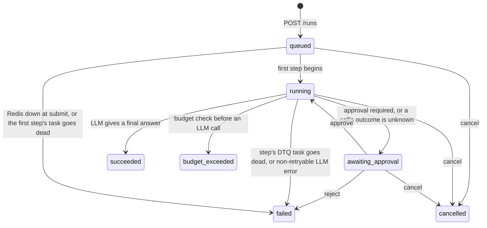

# Agent runtime design

**Status:** agent runtime Phase 0. This revision applies the decisions from two rounds of review ([section 14](#14-decisions)). Nothing is implemented yet.

## 1. What it is

A durable execution layer for LLM agent loops, built as a `dtq/agents/` package on top of the queue. A **run** is one agent working toward a goal. It advances in **turns**: one LLM call, then the tool calls that response requested, run in parallel. Each LLM call, tool call and human approval is a **step**. Every step that does work executes as one DTQ task. A step's outcome is committed to MySQL in the same transaction that creates the steps that follow it.

Goals:

1. A run survives worker crashes and resumes at the interrupted step, not at step 0. A step whose outcome is recorded is never executed again.
2. A tool with side effects is started at most once per call. If a crash leaves its outcome unknown, the runtime asks the tool whether the call happened. If the tool can't tell, the run pauses for a person instead of retrying.
3. Token, cost, LLM-call and wall-time budgets stop a run. Tools can require approval, and runs can be cancelled.

Not in scope for now: streaming, multi-agent runs, and cleaning up old runs.

## 2. Data model

Two new tables in `sql/schema.sql`:

```sql
CREATE TABLE agent_runs (
  id               CHAR(36)    NOT NULL PRIMARY KEY,
  goal             TEXT        NOT NULL,
  status           ENUM('queued','running','awaiting_approval','succeeded','failed',
                        'cancelled','budget_exceeded') NOT NULL DEFAULT 'queued',
  model            JSON        NOT NULL,  -- {"provider": "scripted", "name": "...", "system": "...", "max_output_tokens": 1024}
  tools            JSON        NOT NULL,  -- names of the tools this run may call
  queue            VARCHAR(64) NOT NULL,  -- the DTQ queue its steps run on
  step_max_retries INT         NOT NULL DEFAULT 3,  -- max_retries of each step's DTQ task
  -- Budgets. NULL means no limit.
  max_steps        INT         NOT NULL,  -- LLM calls
  max_tokens       BIGINT      NULL,
  max_cost_micros  BIGINT      NULL,      -- millionths of a US dollar
  max_wall_seconds INT         NULL,      -- excludes time spent awaiting approval
  -- Usage totals, added to as each step is recorded.
  llm_calls        INT         NOT NULL DEFAULT 0,
  input_tokens     BIGINT      NOT NULL DEFAULT 0,
  output_tokens    BIGINT      NOT NULL DEFAULT 0,
  cost_micros      BIGINT      NOT NULL DEFAULT 0,
  -- Where the run is (section 5).
  turn             INT         NOT NULL DEFAULT 0,  -- step_no of the current turn's LLM step
  calls_remaining  INT         NOT NULL DEFAULT 0,  -- tool calls in the current turn still without a result
  next_step_no     INT         NOT NULL DEFAULT 1,  -- next unused step number (step 0 is created with the run)
  paused_seconds   INT         NOT NULL DEFAULT 0,  -- total time spent awaiting approval
  paused_at        DATETIME(6) NULL,                -- set while awaiting approval
  result           JSON        NULL,      -- the final answer
  error            TEXT        NULL,
  created_at       DATETIME(6) NOT NULL DEFAULT CURRENT_TIMESTAMP(6),
  started_at       DATETIME(6) NULL,
  finished_at      DATETIME(6) NULL,
  KEY ix_agent_runs_status_created (status, created_at)
) ENGINE=InnoDB;

CREATE TABLE agent_steps (
  run_id          CHAR(36)    NOT NULL,
  step_no         INT         NOT NULL,
  turn            INT         NOT NULL,   -- the LLM step this step belongs to (its own step_no for an LLM step)
  kind            ENUM('llm','tool','approval') NOT NULL,
  status          ENUM('pending','started','waiting','succeeded','failed','unknown_outcome') NOT NULL,
  attempt         INT         NULL,       -- the DTQ attempt that owns the step (section 5)
  call_id         VARCHAR(64) NULL,       -- tool steps: which call from the LLM response
  input           JSON        NOT NULL,
  output          JSON        NULL,
  input_tokens    INT         NULL,
  output_tokens   INT         NULL,
  cost_micros     BIGINT      NULL,
  idempotency_key VARCHAR(80) NULL,       -- tool steps only (section 7)
  created_at      DATETIME(6) NOT NULL DEFAULT CURRENT_TIMESTAMP(6),
  started_at      DATETIME(6) NULL,
  finished_at     DATETIME(6) NULL,
  PRIMARY KEY (run_id, step_no),
  CONSTRAINT fk_agent_steps_run FOREIGN KEY (run_id) REFERENCES agent_runs (id)
) ENGINE=InnoDB;
```

- **Steps are append-only.** A step row is created when the step is scheduled: as `pending`, or as `waiting` for an approval. It moves to `started` when an attempt begins, and its outcome is written once. A person's decision, or a retry they authorize, becomes a new step. Nothing rewrites a finished step.
- **Step numbers follow creation order.** They come from `next_step_no`, inside transactions that hold the run row's lock. A turn's tool steps are numbered in the order the LLM listed the calls.
- **The plan's single `next_step` column becomes `turn` plus `calls_remaining`,** because a turn's tool calls run at the same time (section 5).
- **Cost is stored in integer micro-dollars**, so totals don't drift the way floats would.
- **Step inputs:**
  - LLM: `{"model", "max_output_tokens", "messages_sha256"}`. The prompt itself is rebuilt from earlier steps (section 6). The hash lets tests check that a re-executed call sent the same prompt.
  - tool: `{"tool", "args"}`.
  - approval: `{"reason": "approval_required" | "unknown_outcome", "calls": [{"call_id", "tool", "args"}]}`.
- **Step outputs:**
  - LLM: a provider-neutral response, `{"text", "tool_calls": [{"id", "name", "args"}], "stop_reason"}`.
  - tool: the return value, or `{"error": ...}`.
  - approval: `{"decision": "approve" | "reject", "note", "tool_output"}`.

## 3. Run states



`succeeded`, `failed`, `cancelled` and `budget_exceeded` are terminal. `awaiting_approval` stops new work from being scheduled. Tool calls already scheduled in the current turn still finish (section 8).

The allowed transitions live in one table in code (`dtq/agents/states.py`). `transition(session, run_id, src, dst, **values)` runs `UPDATE agent_runs SET status = :dst, ... WHERE id = :id AND status IN (:src)` and returns whether a row changed. Moving to a terminal status also sets `finished_at`.

- **The caller names the states it expects to move the run from.** Approving therefore moves only an `awaiting_approval` run to `running`, and never starts a queued one, even though `queued → running` is also a legal move.
- **A move the table doesn't allow raises `InvalidTransition`,** since that is a bug.
- **A run in none of the source states returns False,** which is normal. It has already moved on, for example a cancel that lost a race to an approval.

This is DTQ's conditional claim applied to runs. A test checks that the diagram above matches the table.

## 4. Turns and steps

How a run proceeds:

1. `POST /runs` creates the run, its first LLM step (`pending`, step 0), and that step's DTQ task.
2. The LLM step runs. If the response requests no tools, that response is the final answer, and the run succeeds.
3. Otherwise, the transaction that records the response schedules the turn's tool calls. It creates one tool step per call, each with its own DTQ task, and sets `calls_remaining` to the number of calls. If any call is to a tool that requires approval, it creates one approval step listing those calls instead, and pauses the run. Approving it schedules the tool steps.
4. The tool steps run in parallel, on whichever workers are free. Recording each one decrements `calls_remaining`. The one that takes it to zero creates the next LLM step and its task, which starts the next turn.

Every step that does work is a DTQ task, `agent_step(run_id, step_no)`, on the run's queue. Its task id is `uuid5(AGENT_NS, f"{run_id}:{step_no}")`, so the primary key stops a step from ever having two task rows. The DTQ worker claims, heartbeats, retries and reclaims it like any other task. Approval steps have no task, because they are finished through the API.

Inside, `agent_step` has three phases.

**A. Begin (one transaction)**

1. **Check the run.** A conditional update on the run row matches only if this step's turn is still current (`turn = :turn`) and the run may start this kind of step:
   - an LLM step: the run is queued or running, and a queued run moves to running;
   - a tool step: the run is running or awaiting_approval.

   If nothing matches, the message is stale or the run has ended, so A does nothing and returns. The row lock lasts until A commits, which orders A against a concurrent cancel. Either the cancel commits first and the step never starts, or the step is already in flight and finishes.
2. **Claim the step.** `UPDATE agent_steps SET status = 'started', attempt = :mine, started_at = :now WHERE run_id = :run AND step_no = :n AND status = 'pending'`. If an earlier attempt left the row `started`, section 5 decides whether this attempt may take it over. If the row is finished, or another attempt with a higher number holds it, A does nothing.
3. **For an LLM step,** check the budgets first (section 9), and record the step's input.

**B. Execute (no transaction open)**

Call the LLM or the tool. DTQ's heartbeat keeps the message from being reclaimed, however long this takes.

**C. Record and advance (one transaction)**

1. **Record the outcome.** `UPDATE agent_steps SET status, output, usage, finished_at WHERE run_id = :run AND step_no = :n AND status = 'started' AND attempt = :mine`. If no row matches, another attempt has taken over. Roll back and return.
2. **Add the usage** to the run's totals.
3. **Advance** (section 6):
   - **LLM step with a final answer:** move the run to `succeeded` and set `result`.
   - **LLM step requesting tools:** create the turn's tool steps and their tasks (or the approval step), and set `calls_remaining`.
   - **Tool step:** run one conditional update, `SET calls_remaining = 0, turn = <new LLM step>, ... WHERE id = :run AND turn = :turn AND calls_remaining = 1 AND status = 'running'`. If it matches, this was the turn's last call, so create the next LLM step and its task. If it doesn't, decrement `calls_remaining` (`WHERE turn = :turn`) and create nothing.
   - **Run cancelled, or otherwise not running:** record the outcome and usage, and create nothing.

After the commit, `agent_step` XADDs a message for every task it created and sets their `enqueued_at`, in the same order `POST /tasks` uses. Then it returns, and DTQ records the task as succeeded and acks the message.

**Why the next steps are created inside C's transaction.** Saving a step's outcome and creating what follows it become a single commit. If the worker dies between that commit and the XADDs, the new task rows are `queued` with no `enqueued_at`. DTQ's existing reconciler already re-sends exactly those rows after `RECONCILE_AFTER_SECONDS`, so no new recovery mechanism is needed. This is the transactional-outbox pattern, with DTQ's `tasks` table as the outbox.

`POST /runs` follows the same order as `POST /tasks`. It inserts the run, step 0 and step 0's task in one transaction, then XADDs. If Redis is down, it marks the task dead and the run failed, and returns 503.

**What a step costs.** Each step makes five MySQL commits: DTQ's claim, A, C, setting `enqueued_at` on the steps C created, and DTQ's result. A turn's parallel tool steps all update the run row in C, so their commits wait on each other for that row's lock. Phase 6's benchmark measures both costs.

## 5. Why a run can't fork

**Across turns: `turn` and `calls_remaining`.** Only one turn is current, and A refuses to start a step from an earlier turn. The next LLM step is created exactly once: by the transaction whose conditional update takes `calls_remaining` from 1 to 0. Each tool call's result decrements it at most once, because recording is fenced (below). So a run is a chain of turns that cannot fork, however many duplicate or late messages arrive. This is DTQ's conditional claim, applied to the run row.

This replaces the plan's "exactly one step in flight per run". With parallel tool calls, one turn is in flight, and within it, either its one LLM call or that call's tool calls.

**Within a step: fencing on the DTQ attempt.** One step can have two attempts running at once. DTQ reclaims a message whose worker has gone silent for `VISIBILITY_TIMEOUT_MS`, but that worker may be stalled rather than dead.

- Every DTQ claim increments `tasks.attempts`, so the attempt number is a fencing token that only ever grows.
- A stores the attempt number in `agent_steps.attempt`.
- An attempt may take over a `started` row only if its number is higher.
- C records only if the row still carries the same number.
- A stalled attempt that wakes up finds a higher number, and its outcome is dropped, just as DTQ's `_record` drops a stale task result.

**Why the DTQ attempt, not a separate counter in `agent_steps`.** With two counters, the attempt DTQ considers current could lose the step-level race to a stale attempt. It would report success to DTQ and ack the message. If the stale attempt then crashed, the step would be stuck in `started` with no message left to retry it. Using one token means DTQ and the step always agree on who owns it.

**What this gives:** one current turn per run, at most one recorded outcome per step, and each next turn created exactly once. It does not stop a stalled attempt and a live one from both calling the LLM. The extra call costs tokens, but its output is discarded. Tools are a different matter (section 7).

## 6. Memoization and resuming after a crash

A run's state is its rows. Everything a step needs is rebuilt from recorded steps.

- **Recorded steps are never executed again.** A message for a finished step finds the row finished, so A's claim matches nothing. That is the memoization: the output stored in `agent_steps` is the only copy that is ever used.
- **The LLM prompt is rebuilt from history.** It is built from:
  - the system prompt;
  - the goal, as the first user message;
  - then, for each turn: the LLM step's output as an assistant message, followed by one tool result per call.

  The tool results go in the order the LLM listed the calls, not the order the calls finished, so the prompt is the same whichever call finished first. A call's result is the output of its last tool step, since a retry supersedes an unknown outcome, or the output a person supplied when approving.
- **What comes next depends only on recorded state.**
  - After an LLM step, its recorded response decides: no tool calls means the run succeeds, and otherwise the turn's tool steps (or, from Phase 4, an approval step) are created.
  - After a tool step, `calls_remaining` decides (section 5). It isn't worked out by re-reading the turn's other steps: under concurrency, a transaction can miss a sibling's result that committed while it was waiting for the run row's lock, but the counter is updated under that lock.
- **Resuming is DTQ's reclaim.** The interrupted step's message is reclaimed after the visibility timeout, and the step starts again at A. In the DTQ chaos test, recovery after a worker kill took a median of 31.5 s, set by the 30 s `VISIBILITY_TIMEOUT_MS` (`bench/results/chaos-10000t-w5-k5-20261027-062824.json`).

| worker dies | state it leaves | what happens next |
|---|---|---|
| before A commits | step `pending` | message reclaimed; A runs normally |
| after A, during an LLM call | step `started` | reclaimed; the next attempt takes over and calls the LLM again. The lost call's tokens are not counted (section 9). |
| after A, during a read-only or idempotent tool | step `started` | reclaimed; the tool runs again, and an idempotent one gets the same key |
| after A, during a side-effecting tool | step `started` | reclaimed; the next attempt calls the tool's `check`, or marks the call `unknown_outcome` (section 7) |
| after C commits, before the XADDs | outcome recorded; new task rows with no `enqueued_at` | this message is reclaimed and does nothing; DTQ's reconciler sends the new steps after `RECONCILE_AFTER_SECONDS` |
| after the XADDs, before DTQ records the task | next steps may already be running | this message is reclaimed and does nothing |

## 7. Tools and side effects

Each tool declares one effect. A side-effecting tool can also offer a `check`:

```python
@tool(effect="side_effect", check=notification_sent, requires_approval=False)
def send_notification(to: str, text: str, *, idempotency_key: str) -> dict: ...

def notification_sent(idempotency_key: str) -> dict | None:
    """The call's result if it happened; None if there is no sign that it did."""
```

| effect | meaning | after a crash mid-call |
|---|---|---|
| `read_only` | no external effects | run it again |
| `idempotent` | has effects, but repeating a call with the same key takes effect once. The tool passes the key to a system that dedupes, through an `Idempotency-Key` header or an upsert keyed on it, for example. | run it again with the same key |
| `side_effect` | has effects and is not safe to repeat | never run it again automatically; `check`, or mark it `unknown_outcome` |

A tool that declares no effect is treated as `side_effect`, so forgetting to annotate one fails safe.

- **Idempotency key.** The key is `"<run_id>:<step_no>"` of the step that first ran the call. If a person later authorizes a retry, the retry step reuses the original key, so a system that dedupes still sees one request. Tools that take an `idempotency_key` parameter are passed it.
- **Intent before execution.** A commits the `started` row, key included, before the tool is called. That row records that a call may have begun.
- **Taking over a side-effecting call.** Suppose A finds a `started` row left by an earlier attempt of a `side_effect` tool. The call may or may not have happened. An attempt that takes over never makes the call itself.
  - **If the tool has `check`,** the attempt takes over the row and calls `check(idempotency_key)` in B, instead of the tool.
    - If `check` returns a result, the call happened, so C records it as the step's output and the turn carries on.
    - If it returns None, C marks the step `unknown_outcome`, as below.
    - If it raises, DTQ retries the step. `check` only reads, so a crash during it is handled the same way by the next attempt.
  - **If there is no `check`, or it finds nothing,** the step is marked `unknown_outcome` in one transaction, which also creates an approval step for that call and moves the run to `awaiting_approval` (section 8).
- **Why "no sign of it" still needs a person.** `check` can prove that a call happened, but not that it never will. The attempt that wrote the intent may be stalled rather than dead, and could make the call after a retry has made its own. Only the external system can rule that out, which is what an idempotency key does. So for a tool that isn't idempotent, a retry stays a person's decision.
- **Tool errors.**
  - `ToolError` means the call definitely failed with no effect, for example because its arguments were invalid. The step is recorded as `failed`, and the error goes back to the LLM as the tool result, so the agent can correct itself.
  - Any other exception from a read-only or idempotent tool propagates, so DTQ retries the step with backoff.
  - Any other exception from a side-effecting tool, such as a timeout or a dropped connection, means the effect may have happened. It is handled like a crash: `check` if the tool has one, otherwise `unknown_outcome`.
- **Unknown tools and bad arguments.** An LLM can request a tool that isn't in the run's `tools`, or pass arguments that don't fit its signature. That call is recorded as a `failed` tool step without anything being called, and the error goes back to the LLM.

**What this guarantees:** the runtime starts a `side_effect` call at most once, unless a person authorizes a retry. A person who authorizes one accepts a narrow risk: an earlier attempt that stalled for longer than the visibility timeout, between committing its intent and making the call, could still make it.

**The demo tool and its sink.** The demo `send_notification` tool (Phase 3) writes a row to a `side_effect_sink` table, and its `check` looks the key up there. The sink deliberately has no unique constraint on the key. It records every execution, so the chaos test counts duplicates instead of having the database hide them. The tool's insert is its own transaction, separate from C, as a real external call would be.

## 8. Approvals and cancellation

An approval is a step of kind `approval`. It is how a person's decision enters the run's history. Approval steps are created already `waiting`, and are finished through the API, never by a worker.

- **Tools with `requires_approval`.** If an LLM response requests any of them, C creates one approval step for the turn, listing those calls, and pauses the run. None of the turn's calls run until it is approved, including calls that don't need approval. One decision per turn is enough, because rejecting fails the run anyway (decision 8).
- **Unknown outcomes.** Each call whose outcome is unknown gets its own approval step. The turn's other calls keep running and recording while the run waits (decision 9). The next turn can't start until every call has a result.
- **`POST /runs/{id}/approve`** takes the approval step's `step_no`, so a person approves exactly what they looked at. In one transaction, it marks that step `succeeded` and then:
  - **for a turn's approval,** schedules the turn's tool steps;
  - **for an unknown outcome, with no body,** means "it didn't happen, try again". It creates a new tool step for the same call, with the same key;
  - **for an unknown outcome, with `{"tool_output": ...}`,** means "it happened, and this was the result". That output becomes the call's result. It decrements `calls_remaining`, and if that was the turn's last call, it creates the next LLM step.

  If no other approval step is waiting, the run returns to `running`, and the time since `paused_at` is added to `paused_seconds`. New tasks are XADDed after the commit, as in C.
- **`POST /runs/{id}/reject`** records the decision and moves the run to `failed`.
- **`POST /runs/{id}/cancel`** moves a queued, running or awaiting_approval run to `cancelled`.
  - Steps already executing finish and record their output and usage, but schedule nothing.
  - Messages already queued find the run cancelled at A and do nothing.
  - So a cancel takes effect at the next step boundary, and never interrupts a tool mid-call.
- **Races** between approve, reject and cancel, or a double approve, are settled by the conditional updates. The first to commit wins, and the others get a 409.

## 9. Budgets

The budgets are checked in A of every LLM step, before the call, against the run's usage totals:

| budget | exceeded when |
|---|---|
| `max_steps` | `llm_calls >= max_steps` |
| `max_tokens` | `input_tokens + output_tokens >= max_tokens` |
| `max_cost_micros` | `cost_micros >= max_cost_micros` |
| `max_wall_seconds` | `now - started_at - paused_seconds >= max_wall_seconds` |

Exceeding any of them moves the run to `budget_exceeded`, with the budget named in `error`. `max_steps` counts LLM calls, that is, turns. Time spent awaiting approval doesn't count toward wall time. Cost is tokens multiplied by per-model prices from a table in config. For the ScriptedLLM, tests set the prices.

The limits of this:

- **A run can overshoot by one LLM call.** The check happens before the call, and the call's usage is known only afterwards. The call's `max_output_tokens` is capped at the remaining token budget, which bounds the output side but not the input side.
- **Usage totals can undercount after crashes.** The provider bills a call whose worker crashed before C, but the runtime never saw its usage. `agent_steps.attempt` shows how many attempts a step took. A gateway that dedupes by key would close this gap (section 10).
- **Budgets aren't checked before tool calls.** Wall time doesn't cut off a long tool call, so tools need their own timeouts (section 11).

## 10. LLM providers

```python
class LLMProvider(Protocol):
    def complete(self, request: LLMRequest) -> LLMResponse: ...

@dataclass
class LLMRequest:
    model: str
    system: str
    messages: list[Message]   # provider-neutral: role plus text, tool calls or tool results
    tools: list[ToolSpec]     # name, description, JSON schema from the type hints
    max_output_tokens: int
    idempotency_key: str      # "<run_id>:<step_no>"

@dataclass
class LLMResponse:
    text: str | None
    tool_calls: list[ToolCall]  # id, name, args
    stop_reason: str
    input_tokens: int
    output_tokens: int
```

- **Errors.** Providers are looked up by `run.model["provider"]`. They raise `ProviderError(retryable=...)`.
  - Retryable errors (rate limits, 5xx, timeouts) propagate, so DTQ retries the step with backoff.
  - Non-retryable ones, such as a rejected request, fail the run.
- **ScriptedLLM** is used by every test and benchmark. It returns a fixed sequence of responses, with configured token counts and an optional delay.
  - It picks each response by how many LLM turns the request's history already contains, not by an internal counter. A re-executed step may run in a different worker process and must get the same response there.
  - Scripts are registered by name, and a run selects one with `{"provider": "scripted", "name": "<script>"}`.
- **Real adapters** (Phase 5) map this format to and from Anthropic's and/or OpenAI's tool-calling APIs, both of which can return several tool calls in one response. Env vars enable them. Tests that call them are marked `live` and skipped by default.
- **A future gateway** would be just another provider: an adapter that calls it over HTTP. The runtime doesn't depend on one.
  - The runtime keeps the per-run budgets. A gateway would add what a single run can't see: rate limits and spend across runs, failover between providers, and caching.
  - If the gateway returns its stored response when it sees a key again, a re-executed LLM step costs nothing and gets an identical response. That closes the undercounting gap in section 9.

## 11. Changes to DTQ

These are small, and none changes how existing tasks behave.

1. **Task context.** While a task function runs, the worker sets a context variable holding the task's id and attempt. `agent_step` uses the attempt as its fencing token (section 5).
2. **An `on_dead` hook.** `@task(on_dead=fn)`: when the worker marks a task dead (retries exhausted, poison, bad payload), it calls `fn(session, task)` in the same transaction. `agent_step` uses this to fail the run. Doing it in one transaction means a step's task can never be dead while its run still shows `running`.
3. **Cancelling an `agent_step` task is refused.** `POST /tasks/{id}/cancel` returns 409 for them. Cancelling a step's task would leave the run waiting for a step that never runs, so users cancel the run instead.
4. **Registration.** The worker and API import `dtq.agents`, so `agent_step` is registered and the `/runs` routes are mounted.

How the unfinished DTQ phases affect this:

- **Per-task timeouts (DTQ Phase 4) aren't done.** A hung LLM or tool call would hold its worker forever, because the heartbeat keeps the message alive. Until then, providers and tools must set their own timeouts, such as HTTP client timeouts.
- **Per-worker concurrency (DTQ Phase 5) isn't done.** A worker runs one step at a time, so each LLM or tool call holds a whole worker. A turn's tool calls run in parallel only across workers. With more calls than free workers, the rest wait in the queue.
- **Durability** depends on DTQ's defaults, `innodb_flush_log_at_trx_commit=1` and `appendfsync always`. With either opt-in, a VM crash can lose a recorded step or a step's message.

## 12. What it does not guarantee

- **Exactly-once execution of anything.** LLM calls, read-only and idempotent tools, and `check` may run more than once after a crash. Only the recorded outcome counts.
- **Any order among a turn's tool calls.** They run in parallel, so tools called in the same turn must not depend on each other's effects.
- **Safety for a tool marked `idempotent` that isn't.** The runtime trusts the declaration, and likewise trusts `check`.
- **Knowing that an `unknown_outcome` call didn't happen.** A person decides.
- **Hard budget limits.** There is the one-call overshoot, and tokens from crashed calls go unrecorded.
- **Fast recovery.** Resuming after a worker crash takes about the visibility timeout, 30 s by default.

## 13. How each guarantee will be tested

**Phases 1–4** use the existing unit-test setup, with fakeredis and SQLite and no Docker.

- A crash is simulated by raising, at a chosen point, an exception that DTQ's worker doesn't catch (a `BaseException` subclass). That leaves the message pending and the task `running`, as a killed process would.
- Another worker then reclaims the message with `VISIBILITY_TIMEOUT_MS=0`, as the existing reclaim tests do.
- The crash points are: after A, during B, and after C but before the XADDs.
- Parallel tool steps are interleaved by running their phases in a chosen order in one process, as the existing stalled-worker tests do.

| guarantee | test |
|---|---|
| a multi-turn run completes | a ScriptedLLM run with parallel tool calls ends `succeeded`, with the expected steps and usage totals |
| a turn's calls can finish in any order | finish a turn's tool steps in different orders; the next prompt is identical every time |
| the next turn starts exactly once | two tool steps record at the same time; exactly one LLM step is created |
| a duplicate or stale message changes nothing | deliver a step's message twice, and a message from an earlier turn |
| the run resumes at the interrupted step | crash after A of a later step; the run succeeds, and the ScriptedLLM's call log shows earlier turns called once |
| a stale attempt can't record | interleave two attempts of one step |
| a side-effecting tool is not retried | crash during `send_notification` before it writes; the sink has no row, the step is `unknown_outcome`, and the run is `awaiting_approval` |
| `check` settles a call that happened | crash during `send_notification` after it writes; the sink has one row, and the run continues without a person |
| the next steps survive a crash before the XADDs | crash after C; the reconciler sends them, and the run succeeds |
| a step task that goes dead fails the run | a ScriptedLLM step that always raises a retryable error |
| each budget, including wall time excluding paused time | one test each |
| approve, reject, cancel, and their races | one test each, including approving while a turn's other calls are still running |
| prompt rebuilding | the same prompt whatever order steps are read or finish in |

**Phase 6's chaos test** does the same against the real stack, with `docker kill`. It reports duplicate side effects (from the sink), `unknown_outcome` steps, calls settled by `check`, re-executed steps, and how long runs took to resume.

## 14. Decisions

| # | question | decision |
|---|---|---|
| 1 | How do tools declare their effects? | One `effect`: `read_only`, `idempotent` or `side_effect` (the default) |
| 2 | What does `max_steps` count? | LLM calls (turns) |
| 3 | Does time awaiting approval count toward `max_wall_seconds`? | No. It is tracked in `paused_seconds` and subtracted. |
| 4 | What does reject do? | Fails the run |
| 5 | Can side-effecting tools resolve unknown outcomes? | Yes, through an optional `check(idempotency_key)`, which can only conclude that the call happened |
| 6 | What happens to the run when a step's DTQ task goes dead? | An `on_dead` hook fails the run, in the same transaction |
| 7 | Parallel tool calls? | In scope. A turn's tool calls run in parallel (sections 4 and 5). |
| 8 | One approval per turn, or one per call? | One per turn, covering every call in it that needs approval. A reject fails the whole run, so approving calls one at a time wouldn't let a person do anything more. |
| 9 | While a run waits on one call's unknown outcome, do the turn's other calls keep running? | Yes. They were scheduled before anything went wrong and don't depend on the unknown call. |

