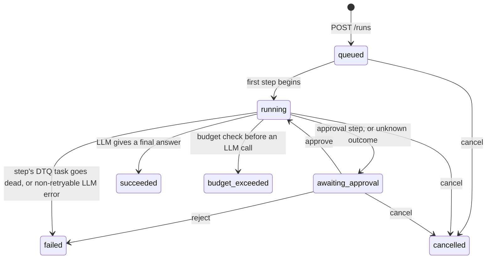

# Agent runtime design

**Status:** draft for review (agent runtime Phase 0). Nothing here is implemented yet. The decisions that need your input are in [section 14](#14-open-questions), each with the option I'd pick.

## 1. What it is

A durable execution layer for LLM agent loops, built as a `dtq/agents/` package on top of the queue. A **run** is one agent working toward a goal. It advances in **steps**: an LLM call, a tool call, or a person's approval. Every step executes as one DTQ task. The step's outcome is committed to MySQL in the same transaction that creates the next step.

Goals:

1. A run survives worker crashes and resumes at the interrupted step, not at step 0. A step whose outcome is recorded is never executed again.
2. A tool with side effects is started at most once per call. If a crash leaves its outcome unknown, the run pauses for a person instead of retrying.
3. Token, cost, step and wall-time budgets stop a run. Tools can require approval, and runs can be cancelled.

Not in scope for now: parallel tool calls within a run, streaming, multi-agent runs, and cleaning up old runs.

## 2. Data model

Two new tables in `sql/schema.sql`:

```sql
CREATE TABLE agent_runs (
  id               CHAR(36)    NOT NULL PRIMARY KEY,
  goal             TEXT        NOT NULL,
  status           ENUM('queued','running','awaiting_approval','succeeded','failed',
                        'cancelled','budget_exceeded') NOT NULL DEFAULT 'queued',
  model            JSON        NOT NULL,  -- {"provider": "scripted", "name": "...", "system": "...", "max_output_tokens": 1024}
  tools            JSON        NOT NULL,  -- names of the tools this run may call
  queue            VARCHAR(64) NOT NULL,  -- the DTQ queue its steps run on
  step_max_retries INT         NOT NULL DEFAULT 3,  -- max_retries of each step's DTQ task
  -- Budgets. NULL means no limit.
  max_steps        INT         NOT NULL,
  max_tokens       BIGINT      NULL,
  max_cost_micros  BIGINT      NULL,      -- millionths of a US dollar
  max_wall_seconds INT         NULL,
  -- Usage totals, added to as each step is recorded.
  llm_calls        INT         NOT NULL DEFAULT 0,
  input_tokens     BIGINT      NOT NULL DEFAULT 0,
  output_tokens    BIGINT      NOT NULL DEFAULT 0,
  cost_micros      BIGINT      NOT NULL DEFAULT 0,
  next_step        INT         NOT NULL DEFAULT 0,  -- the only step number that may run
  result           JSON        NULL,      -- the final answer
  error            TEXT        NULL,
  created_at       DATETIME(6) NOT NULL DEFAULT CURRENT_TIMESTAMP(6),
  started_at       DATETIME(6) NULL,
  finished_at      DATETIME(6) NULL,
  KEY ix_agent_runs_status_created (status, created_at)
) ENGINE=InnoDB;

CREATE TABLE agent_steps (
  run_id          CHAR(36)    NOT NULL,
  step_no         INT         NOT NULL,
  kind            ENUM('llm','tool','approval') NOT NULL,
  status          ENUM('started','waiting','succeeded','failed','unknown_outcome') NOT NULL,
  attempt         INT         NOT NULL,   -- the DTQ attempt that owns the step (section 5)
  input           JSON        NOT NULL,
  output          JSON        NULL,
  input_tokens    INT         NULL,
  output_tokens   INT         NULL,
  cost_micros     BIGINT      NULL,
  idempotency_key VARCHAR(80) NULL,       -- tool steps only (section 7)
  created_at      DATETIME(6) NOT NULL DEFAULT CURRENT_TIMESTAMP(6),
  finished_at     DATETIME(6) NULL,
  PRIMARY KEY (run_id, step_no),
  CONSTRAINT fk_agent_steps_run FOREIGN KEY (run_id) REFERENCES agent_runs (id)
) ENGINE=InnoDB;
```

- **Steps are append-only.** A row is inserted when its step starts, and its outcome is written once. `started` and `waiting` are the only statuses that change later. A person's decision, or a retry they authorize, is recorded as a new step. Nothing rewrites a finished step.
- **Cost is stored in integer micro-dollars**, so totals don't drift the way floats would.
- **Step inputs:**
  - LLM: `{"model", "max_output_tokens", "messages_sha256"}`. The prompt itself is rebuilt from earlier steps (section 6). The hash lets tests check that a re-executed call sent the same prompt.
  - tool: `{"tool", "args", "call_id", "llm_step"}`.
  - approval: `{"reason": "approval_required" | "unknown_outcome", "call_id", "tool", "args"}`.
- **Step outputs:**
  - LLM: a provider-neutral response, `{"text", "tool_calls": [{"id", "name", "args"}], "stop_reason"}`.
  - tool: the return value, or `{"error": ...}`.
  - approval: `{"decision": "approve" | "reject", "note", "tool_output"}`.

## 3. Run states



`succeeded`, `failed`, `cancelled` and `budget_exceeded` are terminal.

The allowed transitions live in one table in code. `transition(session, run_id, to, **values)` runs `UPDATE agent_runs SET status = :to, ... WHERE id = :id AND status IN (<states allowed to move to :to>)` and returns whether a row changed. Requesting a transition the table doesn't allow raises `InvalidTransition`, since that is a bug. Losing a race to another transition returns False, which is normal (approve vs cancel, for example). This is DTQ's conditional claim applied to runs.

## 4. Executing a step

Each step is a DTQ task `agent_step(run_id, step_no)` on the run's queue. Its task id is `uuid5(AGENT_NS, f"{run_id}:{step_no}")`, so the primary key stops a step from ever having two task rows. The DTQ worker claims, heartbeats, retries and reclaims it like any other task. Inside, `agent_step` has three phases.

**A. Begin (one transaction)**

1. `UPDATE agent_runs SET status = 'running', started_at = COALESCE(started_at, :now) WHERE id = :run AND next_step = :step_no AND status IN ('queued', 'running')`.
   - If nothing matches, do nothing and return. The message is a duplicate or late, or the run has finished or is paused.
   - The row lock lasts until A commits, which orders A against a concurrent cancel or approval. Either the cancel commits first and the step never starts, or the step is already in flight and finishes.
2. Load the run's steps, and work out what step `step_no` is from them (section 6).
3. Then, depending on the step:
   - **LLM step:** check the budgets (section 9).
   - **Approval step:** record it as `waiting`, move the run to `awaiting_approval`, and return (section 8).
   - **Any step that goes on to run:** record the intent. Insert the step row as `started` with this attempt, or take over a `started` row left by an earlier attempt (section 5).

**B. Execute (no transaction open)**

Call the LLM or the tool. DTQ's heartbeat keeps the message from being reclaimed, however long this takes.

**C. Record and advance (one transaction)**

1. `UPDATE agent_steps SET status, output, usage, finished_at WHERE run_id = :run AND step_no = :step_no AND status = 'started' AND attempt = :mine`. If no row matches, another attempt has taken over. Roll back and return.
2. `UPDATE agent_runs SET next_step = next_step + 1, <usage totals += this step's> WHERE id = :run AND next_step = :step_no AND status = 'running'`. If the LLM gave a final answer, the same statement sets `status = 'succeeded'` and `result`.
3. If step 2 matched and the run continues, insert the DTQ task row for step `step_no + 1` as `queued` with no `enqueued_at`.
4. If step 2 matched nothing, the run was cancelled while this step ran. Add the usage alone (`WHERE id = :run`) and enqueue nothing.

After the commit, `agent_step` XADDs the next step's message and sets its `enqueued_at`, in the same order `POST /tasks` uses. Then it returns, and DTQ records the task as succeeded and acks the message.

**Why the next step is created inside C's transaction.** Saving step N's outcome and creating step N+1 become a single commit. If the worker dies between that commit and the XADD, step N+1's task row is `queued` with no `enqueued_at`. DTQ's existing reconciler already re-sends exactly those rows after `RECONCILE_AFTER_SECONDS`, so no new recovery mechanism is needed. This is the transactional-outbox pattern, with DTQ's `tasks` table as the outbox.

`POST /runs` follows the same order as `POST /tasks`. It inserts the run and step 0's task in one transaction, then XADDs. If Redis is down, it marks the task dead and the run failed, and returns 503.

A step costs four MySQL commits: DTQ's claim, A, C, and DTQ's result. Phase 6's benchmark measures what that adds per step.

## 5. One step in flight per run

Two mechanisms work together.

**Across steps: `next_step`.** Step N can begin only while `next_step = N`. The only place `next_step` moves to N+1 is C, the transaction that records step N's outcome, and that is also the only place step N+1's task is created. So a run is a single chain. A duplicate or late message for any step changes nothing, and no message can start step N+1 before step N's outcome is saved. This is DTQ's conditional claim, applied to the run row.

**Within a step: fencing on the DTQ attempt.** One step can have two attempts running at once. DTQ reclaims a message whose worker has gone silent for `VISIBILITY_TIMEOUT_MS`, but that worker may be stalled rather than dead.

- Every DTQ claim increments `tasks.attempts`, so the attempt number is a fencing token that only ever grows.
- A stores the attempt number in `agent_steps.attempt`.
- An attempt may take over a `started` row only if its number is higher.
- C records only if the row still carries the same number.
- A stalled attempt that wakes up finds a higher number, and its outcome is dropped, just as DTQ's `_record` drops a stale task result.

**Why the DTQ attempt, not a separate counter in `agent_steps`.** With two counters, the attempt DTQ considers current could lose the step-level race to a stale attempt. It would report success to DTQ and ack the message. If the stale attempt then crashed, the step would be stuck in `started` with no message left to retry it. Using one token means DTQ and the step always agree on who owns it.

**What this gives:** at most one step number is active per run, and each step has at most one recorded outcome. It does not stop a stalled attempt and a live one from both calling the LLM. The extra call costs tokens, but its output is discarded. Tools are a different matter (section 7).

## 6. Memoization and resuming after a crash

A run's state is its rows. Everything the next step needs is rebuilt from recorded steps.

- **Recorded steps are never executed again.** A message for a finished step finds `next_step` past it and does nothing. That is the memoization: the output stored in `agent_steps` is the only copy that is ever used.
- **The LLM prompt is rebuilt from history.** It is built from:
  - the system prompt;
  - the goal, as the first user message;
  - then each earlier step, in order: an LLM step's output becomes an assistant message, and a tool step's output becomes that call's tool result.

  Approval steps add nothing, except when a person supplies a tool's output (section 8).
- **What step N is depends only on history.** `plan_next(run, steps)` decides:
  - After an LLM step that requested tool calls, there is one step per call, in order. If the tool requires approval, an approval step comes first.
  - Once every call from the latest LLM step has a result, the next step is an LLM step.

  It reads only committed rows, so every attempt of step N computes the same step, and it can be tested on its own.
- **Resuming is DTQ's reclaim.** The interrupted step's message is reclaimed after the visibility timeout, and the step starts again at A. In the DTQ chaos test, recovery after a worker kill took a median of 31.5 s, set by the 30 s `VISIBILITY_TIMEOUT_MS` (`bench/results/chaos-10000t-w5-k5-20261027-062824.json`).

Tool calls from one LLM response run one after another, one step each. Running them in parallel would mean several steps in flight per run.

| worker dies | state it leaves | what happens next |
|---|---|---|
| before A commits | nothing recorded | message reclaimed; A runs normally |
| after A, during an LLM call | step `started` | reclaimed; the next attempt takes over and calls the LLM again. The lost call's tokens are not counted (section 9). |
| after A, during a read-only or idempotent tool | step `started` | reclaimed; the tool runs again, and an idempotent one gets the same key |
| after A, during a side-effecting tool | step `started` | reclaimed; the step is marked `unknown_outcome` and the run waits for a person (section 7) |
| after C commits, before the XADD | step recorded; next task row with no `enqueued_at` | this message is reclaimed and does nothing; DTQ's reconciler sends the next step after `RECONCILE_AFTER_SECONDS` |
| after the XADD, before DTQ records the task | next step may already be running | this message is reclaimed and does nothing |

## 7. Tools and side effects

Each tool declares one effect, plus an optional approval flag:

```python
@tool(effect="side_effect", requires_approval=False)
def send_notification(to: str, text: str, *, idempotency_key: str) -> dict: ...
```

| effect | meaning | after a crash mid-call |
|---|---|---|
| `read_only` | no external effects | run it again |
| `idempotent` | has effects, but repeating a call with the same key takes effect once. The tool passes the key to a system that dedupes, through an `Idempotency-Key` header or an upsert keyed on it, for example. | run it again with the same key |
| `side_effect` | has effects and is not safe to repeat | never run it again automatically; mark it `unknown_outcome` |

A tool that declares no effect is treated as `side_effect`, so forgetting to annotate one fails safe.

- **Idempotency key.** The key is `"<run_id>:<step_no>"` of the step that first ran the call. If a person later authorizes a retry, the retry step reuses the original key, so a system that dedupes still sees one request. Tools that take an `idempotency_key` parameter are passed it.
- **Intent before execution.** A commits the `started` row, key included, before the tool is called. That row records that a call may have begun. Suppose A then finds a `started` row left by an earlier attempt of a side-effecting tool. The call may or may not have reached the outside world, so A doesn't run it. Instead, in one transaction, it marks the step `unknown_outcome`, appends an approval step with reason `unknown_outcome`, and pauses the run (section 8).
- **Tool errors.**
  - `ToolError` means the call definitely failed with no effect, for example because its arguments were invalid. The step is recorded as `failed`, and the error goes back to the LLM as the tool result, so the agent can correct itself.
  - Any other exception from a read-only or idempotent tool propagates, so DTQ retries the step with backoff.
  - Any other exception from a side-effecting tool, such as a timeout or a dropped connection, means the effect may have happened. It is treated like a crash: `unknown_outcome`.
- **Unknown tools and bad arguments.** An LLM can request a tool that isn't in the run's `tools`, or pass arguments that don't fit its signature. That call is recorded as a `failed` tool step without anything being called, and the error goes back to the LLM.

**Why the runtime doesn't resolve unknown outcomes itself.** A tool could offer `check(idempotency_key)`, which asks the external system whether the call happened. If it did, recording the result and continuing is safe. If it didn't, retrying is still not safe. The attempt that wrote the intent may be stalled rather than dead, and could still make its call after the retry has made its own. Only the external system can rule that out, which is what an idempotency key does. So for a tool that isn't idempotent, a retry stays a person's decision.

**What this guarantees:** the runtime starts a `side_effect` call at most once, unless a person authorizes a retry. A person who authorizes one accepts a narrow risk: an earlier attempt that stalled for longer than the visibility timeout, between committing its intent and making the call, could still make it.

**The demo tool and its sink.** The demo `send_notification` tool (Phase 3) writes a row to a `side_effect_sink` table. The sink deliberately has no unique constraint on the key. It records every execution, so the chaos test counts duplicates instead of having the database hide them. Its insert is its own transaction, separate from C, as a real external call would be.

## 8. Approvals and cancellation

An approval is a step of kind `approval`. It is how a person's decision enters the run's history.

- **`requires_approval` tools.** `plan_next` puts an approval step before the tool step. A records it as `waiting` and moves the run to `awaiting_approval`. No task is enqueued, and no worker waits.
- **Unknown outcomes** pause the run the same way, with reason `unknown_outcome`.
- **`POST /runs/{id}/approve`** runs one transaction. It marks the `waiting` step `succeeded` with `{"decision": "approve"}`, moves the run from `awaiting_approval` to `running`, advances `next_step`, and inserts the next step's task. It XADDs after the commit, as C does.
  - After an `approval_required` step, the next step runs the tool.
  - After an `unknown_outcome` step, approve with no body means "it didn't happen, try again". The next step is a new tool step for the same call, with the same key.
  - Approve with `{"tool_output": ...}` means "it happened, and this was the result". That output becomes the call's result, and nothing is retried.
- **`POST /runs/{id}/reject`** records the decision and moves the run to `failed`.
- **`POST /runs/{id}/cancel`** moves a queued, running or awaiting_approval run to `cancelled`.
  - A step already executing finishes and records its output and usage (C.4), but enqueues nothing.
  - A message already queued for the next step finds the run cancelled at A and does nothing.
  - So a cancel takes effect at the next step boundary, and never interrupts a tool mid-call.
- **Races** between approve, reject and cancel, or a double approve, are settled by the conditional updates. The first to commit wins, and the others get a 409.

## 9. Budgets

The budgets are checked in A of every LLM step, before the call, against the run's usage totals:

| budget | exceeded when |
|---|---|
| `max_steps` | `llm_calls >= max_steps` |
| `max_tokens` | `input_tokens + output_tokens >= max_tokens` |
| `max_cost_micros` | `cost_micros >= max_cost_micros` |
| `max_wall_seconds` | `now - started_at >= max_wall_seconds` |

Exceeding any of them moves the run to `budget_exceeded`, with the budget named in `error`. Cost is tokens multiplied by per-model prices from a table in config. For the ScriptedLLM, tests set the prices.

The limits of this:

- **A run can overshoot by one LLM call.** The check happens before the call, and the call's usage is known only afterwards. The call's `max_output_tokens` is capped at the remaining token budget, which bounds the output side but not the input side.
- **Usage totals can undercount after crashes.** The provider bills a call whose worker crashed before C, but the runtime never saw its usage. `agent_steps.attempt` shows how many attempts a step took. A gateway that dedupes by key would close this gap (section 10).
- **Wall time is checked only before LLM calls**, so it doesn't cut off a long tool call. Tools need their own timeouts (section 11).

## 10. LLM providers

```python
class LLMProvider(Protocol):
    def complete(self, request: LLMRequest) -> LLMResponse: ...

@dataclass
class LLMRequest:
    model: str
    system: str
    messages: list[Message]   # provider-neutral: role plus text, tool calls or tool results
    tools: list[ToolSpec]     # name, description, JSON schema from the type hints
    max_output_tokens: int
    idempotency_key: str      # "<run_id>:<step_no>"

@dataclass
class LLMResponse:
    text: str | None
    tool_calls: list[ToolCall]  # id, name, args
    stop_reason: str
    input_tokens: int
    output_tokens: int
```

- **Errors.** Providers are looked up by `run.model["provider"]`. They raise `ProviderError(retryable=...)`.
  - Retryable errors (rate limits, 5xx, timeouts) propagate, so DTQ retries the step with backoff.
  - Non-retryable ones, such as a rejected request, fail the run.
- **ScriptedLLM** is used by every test and benchmark. It returns a fixed sequence of responses, with configured token counts and an optional delay.
  - It picks each response by how many LLM steps the request's history already contains, not by an internal counter. A re-executed step may run in a different worker process and must get the same response there.
  - Scripts are registered by name, and a run selects one with `{"provider": "scripted", "name": "<script>"}`.
- **Real adapters** (Phase 5) map this format to and from Anthropic's and/or OpenAI's tool-calling APIs. Env vars enable them. Tests that call them are marked `live` and skipped by default.
- **A future gateway** would be just another provider: an adapter that calls it over HTTP. The runtime doesn't depend on one.
  - The runtime keeps the per-run budgets. A gateway would add what a single run can't see: rate limits and spend across runs, failover between providers, and caching.
  - If the gateway returns its stored response when it sees a key again, a re-executed LLM step costs nothing and gets an identical response. That closes the undercounting gap in section 9.

## 11. Changes to DTQ

These are small, and none changes how existing tasks behave.

1. **Task context.** While a task function runs, the worker sets a context variable holding the task's id and attempt. `agent_step` uses the attempt as its fencing token (section 5).
2. **An `on_dead` hook.** `@task(on_dead=fn)`: when the worker marks a task dead (retries exhausted, poison, bad payload), it calls `fn(session, task)` in the same transaction. `agent_step` uses this to fail the run. Without it, a run whose step task died would stay `running` forever.
3. **Cancelling an `agent_step` task is refused.** `POST /tasks/{id}/cancel` returns 409 for them. Cancelling a step's task would leave the run waiting for a step that never runs, so users cancel the run instead.
4. **Registration.** The worker and API import `dtq.agents`, so `agent_step` is registered and the `/runs` routes are mounted.

How the unfinished DTQ phases affect this:

- **Per-task timeouts (DTQ Phase 4) aren't done.** A hung LLM or tool call would hold its worker forever, because the heartbeat keeps the message alive. Until then, providers and tools must set their own timeouts, such as HTTP client timeouts.
- **Per-worker concurrency (DTQ Phase 5) isn't done.** A worker runs one step at a time, so an LLM call holds a worker for its whole latency. Across all runs, at most one step per worker is in flight.
- **Durability** depends on DTQ's defaults, `innodb_flush_log_at_trx_commit=1` and `appendfsync always`. With either opt-in, a VM crash can lose a recorded step or a step's message.

## 12. What it does not guarantee

- **Exactly-once execution of anything.** LLM calls and read-only or idempotent tools may run more than once after a crash. Only the recorded outcome counts.
- **Safety for a tool marked `idempotent` that isn't.** The runtime trusts the declaration.
- **Knowing whether an `unknown_outcome` call happened.** A person decides.
- **Hard budget limits.** There is the one-call overshoot, and tokens from crashed calls go unrecorded.
- **Fast recovery.** Resuming after a worker crash takes about the visibility timeout, 30 s by default.

## 13. How each guarantee will be tested

**Phases 1–4** use the existing unit-test setup, with fakeredis and SQLite and no Docker.

- A crash is simulated by raising, at a chosen point, an exception that DTQ's worker doesn't catch (a `BaseException` subclass). That leaves the message pending and the task `running`, as a killed process would.
- Another worker then reclaims the message with `VISIBILITY_TIMEOUT_MS=0`, as the existing reclaim tests do.
- The crash points are: after A, during B, and after C but before the XADD.

| guarantee | test |
|---|---|
| a multi-step run completes | a ScriptedLLM run with tool calls ends `succeeded`, with the expected steps and usage totals |
| a duplicate step message changes nothing | deliver step N's message twice |
| the run resumes at the interrupted step | crash after A of a later step; the run succeeds, and the ScriptedLLM's call log shows earlier steps called once |
| a stale attempt can't record | interleave two attempts, like the existing stalled-worker tests |
| a side-effecting tool is not retried | crash during `send_notification`; the sink has one row, the step is `unknown_outcome`, and the run is `awaiting_approval` |
| the next step survives a crash before the XADD | crash after C; the reconciler sends the next step and the run succeeds |
| a step task that goes dead fails the run | a ScriptedLLM step that always raises a retryable error |
| each budget, approve, reject, cancel, and their races | one test each |
| `plan_next` | table-driven cases |

**Phase 6's chaos test** does the same against the real stack, with `docker kill`. It reports duplicate side effects (from the sink), `unknown_outcome` steps, re-executed steps, and how long runs took to resume.

## 14. Open questions

1. **One `effect` enum, or three flags?** I'd use the enum (section 7). The plan lists `read_only`, `idempotent` and `side_effect` as flags. With flags, one tool could claim to be both read-only and side-effecting.
2. **What does `max_steps` count?** I'd count LLM calls, that is, agent turns. Counting every step would make the limit depend on how many tools each turn happens to call.
3. **Does waiting for approval count toward `max_wall_seconds`?** I'd exclude it. Otherwise a run that waits overnight for approval fails the moment it resumes. Excluding it needs a `paused_seconds` column.
4. **On reject, fail the run, or tell the agent?** The plan says fail it. The alternative is to record the rejection as the tool's result ("the user declined this action") and let the agent carry on, which is what most agent frameworks do. It could be a per-run setting.
5. **Should side-effecting tools be able to offer `check(key)`,** to settle unknown outcomes where the effect provably happened (section 7)? I'd leave it out of Phase 3 and add it when a real tool needs it.
6. **Dead step tasks: an `on_dead` hook, or a reconciler?** I'd use the hook. It is atomic, has no delay, and is a small DTQ change. A reconciler is the more familiar DTQ pattern, but runs would stay `running` until it next ran.
7. **Parallel tool calls** (several steps in flight per run) are out of scope. Is it OK to leave them for later?
